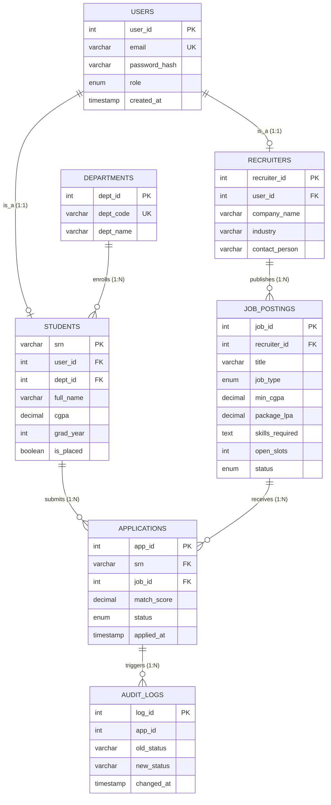

# Campus Internship & Placement Management System (PESU HireSync)

**Course:** UE23CS351A — Database Management Systems (Experiential Learning Level 3 Mini-Project)  
**Department:** Department of Computer Science and Engineering (AI & ML), PES University  

### Team Members
| SRN | Name | Section |
| :--- | :--- | :--- |
| `PES1UG24AM126` | K.R. Tanishkaa | 5 C |
| `PES1UG25AM807` | Pavithra B | 5 C |

---

## 1. Overview & Problem Statement

**PESU HireSync** is a full-stack campus recruitment and placement management portal built for **Students**, **Corporate Recruiters**, and **Placement Cell Administrators**. Traditional campus placement workflows depend on fragmented spreadsheets and manual CGPA checks, resulting in duplicate applications, inconsistent offer tracking, and rigid data models that struggle to represent evolving student portfolios.

To solve this, the system implements a **polyglot persistence architecture** combining:
* **MySQL 8 (Relational Database):** Enforces strict ACID transactions, referential integrity, `CHECK` and `UNIQUE` constraints, stored procedures for eligibility validation, stored functions for candidate priority scoring, Common Table Expressions (CTEs) for placement analytics, `AFTER UPDATE` triggers for automated slot management and audit logging, and database-level Role-Based Access Control (RBAC).
* **MongoDB (NoSQL Document Store):** Stores flexible, schema-less student portfolio documents (`campus_placement_nosql.student_resumes`) with variable-length arrays of technical skills and academic projects, supporting live Read, Update (Upsert), and Delete (RUD) operations.
* **Next.js App Router (Frontend & API Layer):** Provides a role-gated SaaS web interface and server-side REST API routes (`/api/*`) using role-specific database connection pools.

---

## 2. Project Directory Structure

```text
campus-placement-system/
├── database/
│   ├── 01_schema_ddl.sql          # Relational DDL: Tables, PKs, FKs, CHECK & UNIQUE constraints
│   ├── 02_seed_dml.sql            # Sample dataset + INSERT, UPDATE, DELETE DML statements
│   ├── 03_advanced_sql.sql        # Stored Procedure, Function, Trigger, Joins, Subqueries, CTEs
│   └── 04_rbac_roles.sql          # MySQL Database Roles & Least-Privilege Users
├── web-app/
│   ├── .env.local                 # Local MySQL RBAC & MongoDB connection credentials (gitignored)
│   ├── jsconfig.json              # Path alias configuration (@/*)
│   ├── package.json               # Next.js, React, mysql2, and mongodb dependencies
│   └── src/
│       ├── lib/
│       │   ├── db.js              # Role-based MySQL connection pool factory
│       │   └── mongodb.js         # Global MongoDB connection singleton
│       └── app/
│           ├── globals.css        # SaaS UI design system
│           ├── layout.js          # Root layout & metadata
│           ├── page.js            # Role-based authentication login portal
│           ├── dashboard/
│           │   └── page.js        # Unified Student / Recruiter / Admin dashboard
│           └── api/
│               ├── auth/login/route.js    # User authentication & profile resolution
│               ├── jobs/route.js          # Job postings GET & RBAC-enforced POST
│               ├── applications/route.js  # Stored procedure apply & trigger status update
│               ├── analytics/route.js     # CTE placement analytics & trigger audit logs
│               ├── match/route.js         # MongoDB NoSQL portfolio RUD API
│               └── users/route.js         # Registered students & recruiters directory
├── .gitignore
└── README.md
```

---

## 3. Database Architecture

### Entity-Relationship Diagram (Mermaid)


### Normalized Relational Schema (3NF / BCNF)
* **`USERS`** (<u>`user_id`</u>, `email` [UNIQUE], `password_hash`, `role` [ENUM], `created_at`)
* **`DEPARTMENTS`** (<u>`dept_id`</u>, `dept_code` [UNIQUE], `dept_name`)
* **`STUDENTS`** (<u>`srn`</u>, *`user_id`* $\rightarrow$ `USERS`, *`dept_id`* $\rightarrow$ `DEPARTMENTS`, `full_name`, `cgpa` [CHECK 0–10], `grad_year` [CHECK $\ge 2024$], `is_placed`)
* **`RECRUITERS`** (<u>`recruiter_id`</u>, *`user_id`* $\rightarrow$ `USERS`, `company_name`, `industry`, `contact_person`)
* **`JOB_POSTINGS`** (<u>`job_id`</u>, *`recruiter_id`* $\rightarrow$ `RECRUITERS`, `title`, `job_type` [ENUM], `min_cgpa` [CHECK 0–10], `package_lpa` [CHECK $> 0$], `skills_required`, `open_slots` [CHECK $\ge 0$], `status` [ENUM], `created_at`)
* **`APPLICATIONS`** (<u>`app_id`</u>, *`srn`* $\rightarrow$ `STUDENTS`, *`job_id`* $\rightarrow$ `JOB_POSTINGS`, `match_score`, `status` [ENUM], `applied_at`, `UNIQUE(srn, job_id)`)
* **`AUDIT_LOGS`** (<u>`log_id`</u>, `app_id`, `old_status`, `new_status`, `changed_at`)

---

## 4. Key Database Features Implemented

1. **Stored Procedure (`sp_apply_for_job`):** Validates that the target job posting is `OPEN`, has `open_slots > 0`, and that the student's CGPA meets `min_cgpa` before inserting an application record; raises custom `SQLSTATE '45000'` errors on violations.
2. **Stored Function (`fn_compute_priority_tier`):** Deterministic function computing a composite candidate priority index from CGPA and match score, classifying applicants into `TIER_1_FASTTRACK`, `TIER_2_STANDARD`, or `TIER_3_REVIEW`.
3. **Database Trigger (`trg_after_application_update`):** Fires `AFTER UPDATE` on `applications` to log every status change into `audit_logs`. When an applicant's status changes to `SELECTED`, it automatically sets `students.is_placed = TRUE`, decrements `job_postings.open_slots`, and closes the posting if slots reach `0`.
4. **Analytical Queries:** Multi-table `INNER JOIN` pipeline, correlated subquery identifying students outperforming their department's average CGPA, `DeptSummary` Common Table Expression (CTE) computing department placement percentages, and a `RECURSIVE` CTE generating a CGPA eligibility ladder (`6.00` to `9.50`).
5. **Database-Level RBAC (`04_rbac_roles.sql`):** Defines MySQL roles (`role_student`, `role_recruiter`, `role_placement_admin`) bound to dedicated MySQL users (`app_student`, `app_recruiter`, `app_admin`), enforced dynamically per API session via `src/lib/db.js`.
6. **MongoDB NoSQL RUD (`campus_placement_nosql.student_resumes`):** Supports schema-flexible student portfolio creation/updates (`updateOne` with `upsert: true`), skill regex queries (`$regex`), and administrative document deletion (`deleteOne`).

---

## 5. Local Setup & Execution Instructions

### Prerequisites
* **Node.js** (v18+)
* **MySQL Server** (v8.0+)
* **MongoDB Community Server** (running on `mongodb://localhost:27017`)

### Step 1: Load MySQL Schema, Seed Data, Procedures & RBAC Roles
Open PowerShell in the project root directory and run:
```powershell
Get-Content database\01_schema_ddl.sql | mysql -u root -p
Get-Content database\02_seed_dml.sql | mysql -u root -p
Get-Content database\03_advanced_sql.sql | mysql -u root -p
Get-Content database\04_rbac_roles.sql | mysql -u root -p
```

### Step 2: Seed MongoDB NoSQL Student Portfolios
Ensure the MongoDB Windows service is running, then seed initial documents via `mongosh`:
```powershell
mongosh campus_placement_nosql --eval 'db.student_resumes.insertMany([{srn:"PES1UG24AM126",name:"K.R. Tanishkaa",dept:"CSE-AIML",bio:"Full-stack MERN & AI developer specializing in React, Node.js, MySQL, and MongoDB.",skills:["C++","Python","React","Node.js","MongoDB","MySQL"],projects:["Campus Ride-Share Matching","Network Activity Monitoring Dashboard"]},{srn:"PES1UG25AM807",name:"Pavithra B",dept:"CSE-AIML",bio:"Machine Learning & Computer Vision engineer experienced with PyTorch and SQL.",skills:["Python","PyTorch","Computer Vision","SQL"],projects:["AI Vision CTF Solver"]},{srn:"PES1UG24CS045",name:"Khushi R",dept:"CSE",bio:"Systems and network security engineer skilled in Linux, C, and IPv4 packet analysis.",skills:["Linux","Networking","Cybersecurity","C"],projects:["Packet Sniffer CLI"]}])'
```

### Step 3: Configure Environment Variables (`web-app/.env.local`)
Create `web-app/.env.local` with the following configuration:
```env
DB_HOST=localhost
DB_NAME=campus_placement_db
ADMIN_DB_USER=app_admin
ADMIN_DB_PASS=Admin@123
STUDENT_DB_USER=app_student
STUDENT_DB_PASS=Student@123
RECRUITER_DB_USER=app_recruiter
RECRUITER_DB_PASS=Recruiter@123

MONGODB_URI=mongodb://localhost:27017
MONGODB_DB=campus_placement_nosql
```

### Step 4: Install Dependencies & Run Next.js Application
```powershell
cd web-app
npm install
npm run dev
```
Open **`http://localhost:3000`** in your browser.

---

## 6. Demo Credentials

| Role | Email | Password | MySQL RBAC User |
| :--- | :--- | :--- | :--- |
| **Student** | `tanishkaa@pesu.pes.edu` | `pass123` | `app_student` |
| **Recruiter** | `hr@vehere.com` | `recruiter123` | `app_recruiter` |
| **Admin** | `placement.admin@pes.edu` | `admin123` | `app_admin` |